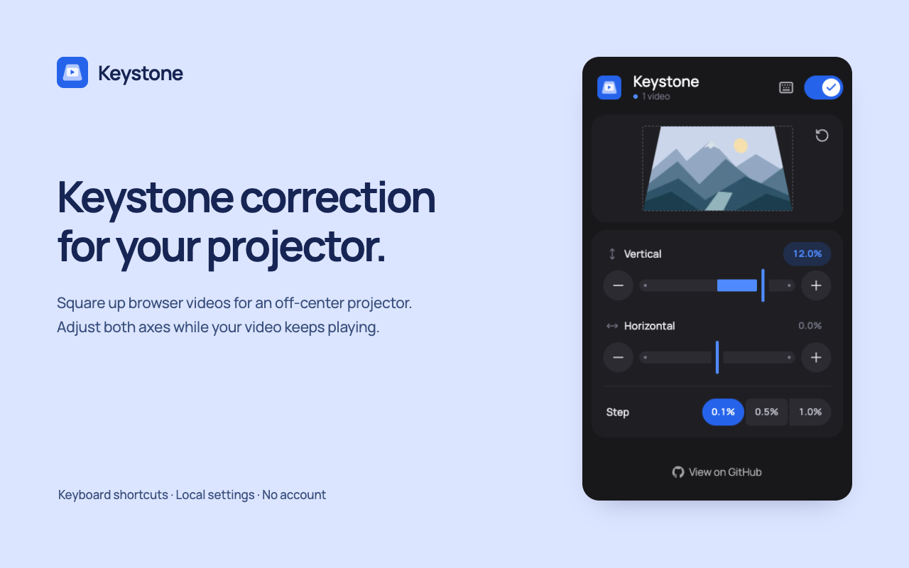

<p align="center">
  
</p>
<h1 align="center">Keystone</h1>
<p align="center">Square up your video. Keep your projector where it fits.</p>
<p align="center">A local-first Chrome extension for vertical and horizontal video perspective correction.</p>



A projector sitting below or beside the screen can turn a rectangle into a trapezoid. Keystone lets you compensate in the browser with two sliders, precise steps and keyboard shortcuts, while the video keeps playing.

This is the browser companion to [Keystone for IINA](https://github.com/lenadweb/iina-plugin-keystone). No account, analytics or subscription.

## What it does

- Applies a projective CSS transform to HTML video, with correction up to 20% in either direction on each axis.
- Finds dynamically added videos, accessible player iframes and open shadow roots.
- Offers a live still-image preview when the browser permits reading the video frame, with a geometric fallback for protected or cross-origin video.
- Saves one global setup locally, shared across tabs and restored after restart.
- Provides 0.1%, 0.5% and 1% adjustment steps, estimated tilt angles and reset controls.
- Restores the video's original inline styles when correction is disabled.

## Install from source

Use Node.js **22.12 or later** and npm 10. No store release is linked until one is published.

```bash
nvm use
npm ci
npm run build
```

Open `chrome://extensions`, enable **Developer mode**, choose **Load unpacked** and select `dist/`. Pin Keystone to the toolbar. Open a page with video, then open the popup. Existing tabs can usually be picked up without a reload; reload if a player does not respond.

For development, run `npm run dev` to watch the popup, worker and content script. Reload the extension after changing the manifest or service worker.

## Adjust the picture

Narrow the edge that looks too wide on the physical screen:

| Projector position                | Edge to narrow |
| --------------------------------- | -------------- |
| Below the screen, tilted upward   | Top            |
| Above the screen, tilted downward | Bottom         |
| Left of the screen, turned right  | Right          |
| Right of the screen, turned left  | Left           |

Use the popup sliders for broad changes and the plus/minus buttons for fine adjustment. The power switch temporarily disables correction without discarding your setup. Settings affect every supported video, not just the current tab.

The displayed tilt is an estimate for a **1.2:1 throw ratio and 16:9 image**, not a projector calibration measurement.

### Keyboard shortcuts

| Action              | macOS            | Windows / Linux  |
| ------------------- | ---------------- | ---------------- |
| Narrow top          | Command+Shift+,  | Alt+Shift+Up     |
| Narrow bottom       | Command+Shift+.  | Alt+Shift+Down   |
| Reset both axes     | Option+Shift+0   | Alt+Shift+0      |
| Toggle correction   | Command+Shift+K  | Ctrl+Shift+K     |
| Narrow left / right | Assign in Chrome | Assign in Chrome |

Customize bindings at `chrome://extensions/shortcuts`, also reachable from the keyboard button in the popup. Chrome permits only four suggested shortcuts and can leave conflicting bindings unassigned. Shortcuts show a brief on-screen readout and can work in container-based fullscreen players.

## Privacy and permissions

Keystone makes no network requests. Settings stay in `chrome.storage.local`. While the popup is open, it attempts to read a small still frame from the largest accessible video, initially and about every ten seconds. That preview exists only in popup memory and is never uploaded or written to persistent storage. The correction itself uses CSS and does not process video frames in JavaScript.

| Permission   | Purpose                                                                         |
| ------------ | ------------------------------------------------------------------------------- |
| `storage`    | Save correction, enabled state and adjustment step                              |
| `scripting`  | Initialize an already-open page, count videos and capture a local popup preview |
| `<all_urls>` | Apply correction across video sites and embedded frames                         |

Chrome blocks extension access to some pages. Access can also be limited through Chrome's site-access settings. See the [privacy policy](PRIVACY.md) and [store permission explanations](store/permissions.md) for exact behavior.

## Limitations

- A `<video>` that is itself the fullscreen element may ignore CSS transforms. Container-based player fullscreen can work; picture-in-picture is outside the page and is not corrected.
- Protected video and platform-specific playback paths can restrict transforms or previews. No particular streaming service is guaranteed to work.
- Native video controls are transformed with the video. Separate player controls are unchanged.
- Inline correction exposes the surrounding page at the narrowed edges. It does not correct the whole desktop or the projector's own menus.
- A site's own video transforms can conflict during correction. Keystone restores the latest observed inline styles when disabled.
- Closed shadow roots and restricted frames are inaccessible. A shadow root attached after its host has already been scanned may require reinsertion or a page reload.
- Digital correction reduces the effective resolution toward the narrowed edge.

## Development

```bash
npm run check           # lint, no-comments check, types and unit tests
npx playwright install chromium
npm run test:browser    # real unpacked extension in Chromium
npm run package         # check, build, validate and create release ZIP + SHA-256
npm run assets          # regenerate PNG icons from the SVG master
npm run promo           # capture the extension and regenerate store/social images
npm run format:check
```

`npm run build` never changes the version. For a release, use `npm version patch --no-git-tag-version` (or `minor` / `major`); its version hook synchronizes the manifest and npm updates the lockfile. See the [release guide](docs/RELEASING.md) before tagging or publishing.

| Directory      | Responsibility                                                              |
| -------------- | --------------------------------------------------------------------------- |
| `src/shared/`  | Geometry, validated settings, commands and translations                     |
| `src/content/` | Discovery, reversible video styles, lifecycle and on-screen feedback        |
| `src/popup/`   | React interface and active-page preview                                     |
| `src/worker/`  | Serialized keyboard-command handling                                        |
| `public/`      | Manifest, translations, toolbar icons and redistributed licenses            |
| `tests/`       | Geometry/settings tests, browser integration and original demo fixture      |
| `scripts/`     | Build validation, packaging, version sync and reproducible media generation |
| `store/`       | Listing copy, review answers and ready-to-upload images                     |

Types, enums and constants have dedicated folders within their runtime context. Pure calculations live in `utils/`; Chrome calls live in `services/`; content state and DOM effects are split into `controllers/` and `dom/`. `npm run lint:architecture` enforces these boundaries.

Read the [architecture notes](docs/ARCHITECTURE.md), [contribution guide](CONTRIBUTING.md) and [security policy](SECURITY.md).

## License

Code and original artwork: [MIT](LICENSE), © 2026 lenadweb. Manrope: [SIL Open Font License 1.1](public/licenses/Manrope-OFL.txt). Bundled dependency licenses are included in [third-party notices](public/licenses/THIRD_PARTY_NOTICES.txt) and every release ZIP.
